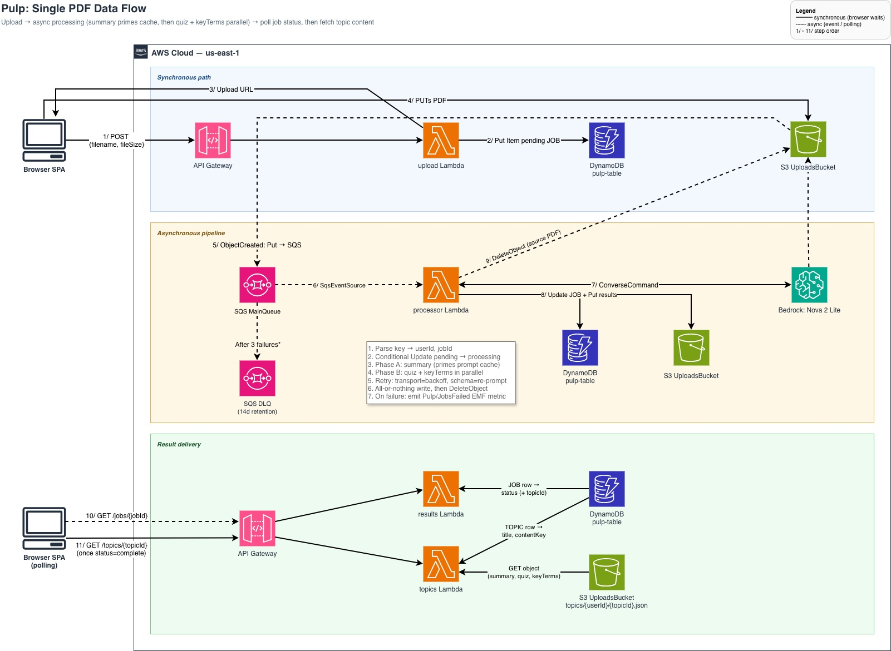

# Pulp

> Upload a PDF, get back a summary, a key-term list, and a 25-question quiz — generated by an LLM, served from a fully serverless AWS backend.


Pulp is a personal project exploring how far a **fully managed, event-driven, Lambda-only** architecture can go under a **hard $5/month AWS budget** — no servers, no containers, no VPC, no idle capacity. The deployed instance is **invite-only** (accounts are created on approval), so this repo is the source of truth: the code, the infrastructure-as-code, and an [architecture write-up](architecture/ARCHITECTURE.md) you can read end to end.



## What this demonstrates

- **Cost-first serverless design.** Every component is pay-per-use and emits CloudWatch metrics out of the box. The recurring idle cost target is ~$0.
- **Direct browser → S3 uploads** via presigned PUT URLs — Lambda signs the URL but never streams the PDF, so function duration and memory don't scale with file size.
- **Async AI pipeline with a brittleness budget.** S3 → SQS → Lambda → Bedrock, with a DLQ, idempotency guards, schema validation of every model response, and all-or-nothing writes so a bad model call never corrupts persisted state.
- **Security defaults baked in.** Private S3 + CloudFront OAC, TLS-only bucket policies, WAF rate-limiting on auth routes, a native Cognito JWT authorizer, least-privilege IAM scoped by ARN, and no email/account enumeration on public endpoints.
- **Single-developer operability.** Two CDK stacks, a `Makefile` of operational targets, and a Jest + smoke-test workflow.

## Architecture

Two CDK stacks in `us-east-1`, with one-way references (app → data):

- **`PulpDataStack`** — stateful resources (`RemovalPolicy.RETAIN`): Cognito user pool, DynamoDB single-table, uploads S3 bucket, main SQS queue + DLQ, SES sender identity, and the Cognito `customMessage` Lambda for the branded welcome email.
- **`PulpAppStack`** — compute + edge + observability: HTTP API Gateway with a JWT authorizer, request-handler Lambdas (`upload`, `results`, `topics`, `attempts`, `join-request`), the SQS-triggered `processor` Lambda, CloudFront + WAF, the frontend S3 bucket (`RETAIN`), and CloudWatch alarms + an AWS Budget on an SNS topic.

The full topology, request flow, and trade-offs are documented in **[architecture/ARCHITECTURE.md](architecture/ARCHITECTURE.md)** (its section numbers match the numbered steps in the diagram). Product requirements live in **[planning/SPEC.md](planning/SPEC.md)**.

## Repository layout

```
cdk/            CDK v2 app — bin/, lib/ (pulp-data-stack.ts, pulp-app-stack.ts), lambdas/
frontend/       Single-file Preact SPA (index.html) — no bundler, no build step
scripts/        Operational scripts (admin-create-user, list-requests, reject-request, smoke, …)
architecture/   ARCHITECTURE.md + the draw.io data-flow diagram
planning/       SPEC.md
Makefile        Deploy + operational targets
CLAUDE.md       Contributor/agent guidance and design constraints
```

## Tech stack

- **Infra:** AWS CDK v2 (TypeScript) — Lambda, API Gateway (HTTP API), DynamoDB, S3, SQS, Cognito, CloudFront, WAF, SES, CloudWatch, SNS, AWS Budgets
- **AI:** Amazon Bedrock — Nova 2 Lite (`amazon.nova-2-lite-v1:0`), invoked via the Converse API
- **Frontend:** Preact in a single `index.html` — deployed with `aws s3 cp` + a CloudFront invalidation

---

## How it runs

### Prerequisites

- **Node 18+** — AWS SDK v3 and the smoke script (global `fetch`) require it.
- **AWS CLI v2**, configured with credentials that deploy to your target account.
- **`jq`** — the `Makefile` reads `cdk/outputs.json` with it.
- **CDK v2 bootstrapped** in `us-east-1`: `cd cdk && npx cdk bootstrap`.
- **Bedrock Nova 2 Lite access** enabled in `us-east-1` (Bedrock console → Model access → `amazon.nova-2-lite-v1:0`).
- **An Amazon SES sender identity** verified in `us-east-1` — Pulp delivers the account-approval welcome email through SES. 

### Deployment

```bash
cd cdk && npm install && cd ..
make deploy-backend      # cdk deploy both stacks; refreshes cdk/outputs.json
make deploy-frontend     # uploads index.html and invalidates CloudFront /*
```

## Granting access (invite-only)

Self-signup is **off** (`selfSignUpEnabled: false`); accounts are created on approval:

1. **A prospective user requests access** — the SPA calls the public `POST /auth/join-request`, which records a `JOINREQ#<email>` row and notifies the operator via SNS. No account is created yet, and the endpoint returns an identical response whether or not the email already exists (no enumeration).
2. **The operator reviews pending requests:**
   ```bash
   make list-requests              # all requests
   make list-requests STATUS=pending
   ```
3. **Approve or reject:**
   ```bash
   make admin-create-user EMAIL=user@example.com   # Cognito AdminCreateUser + branded SES welcome email
   make reject-request    EMAIL=user@example.com   # marks the request rejected
   ```

`make admin-create-user` triggers Cognito's `customMessage` Lambda, which replaces the default invitation email with the Pulp-branded welcome HTML and ships it via SES. On first sign-in the user is prompted to set a permanent password.

## Documentation

- **[architecture/ARCHITECTURE.md](architecture/ARCHITECTURE.md)** — system design, request flow, and trade-offs.
- **[architecture/Pulp_Dataflow.drawio](architecture/Pulp_Dataflow.drawio)** — editable data-flow diagram.
- **[planning/SPEC.md](planning/SPEC.md)** — product requirements and acceptance criteria.
